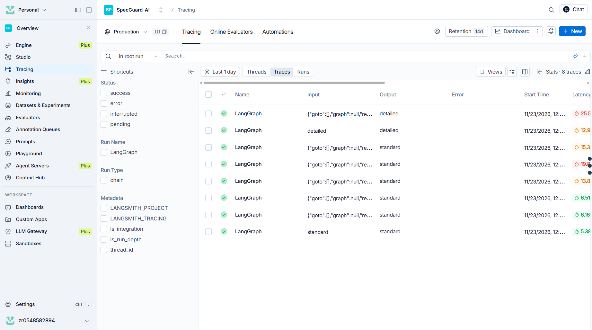
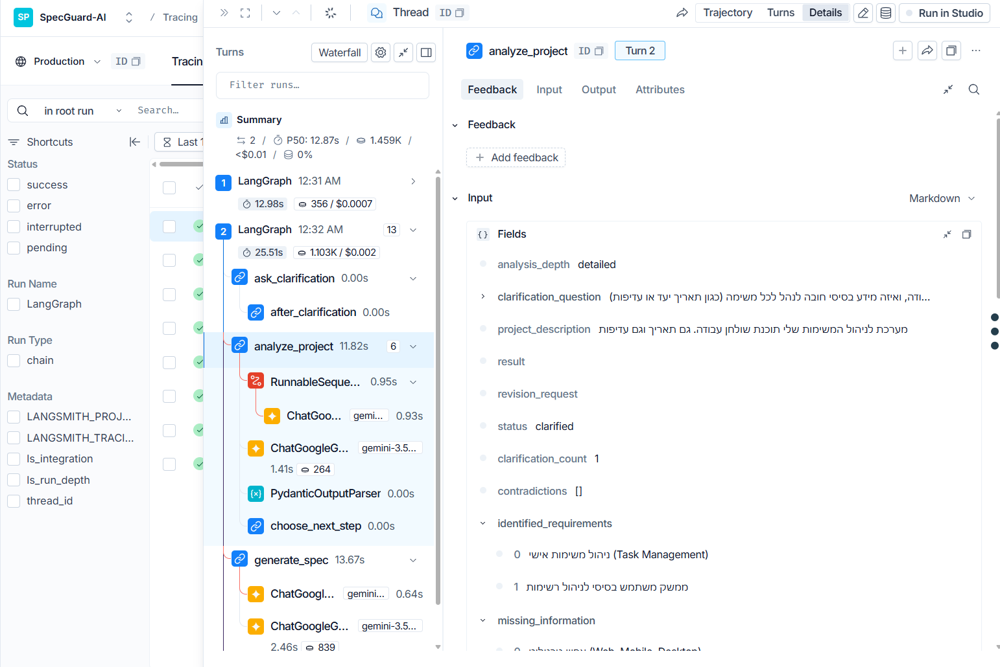
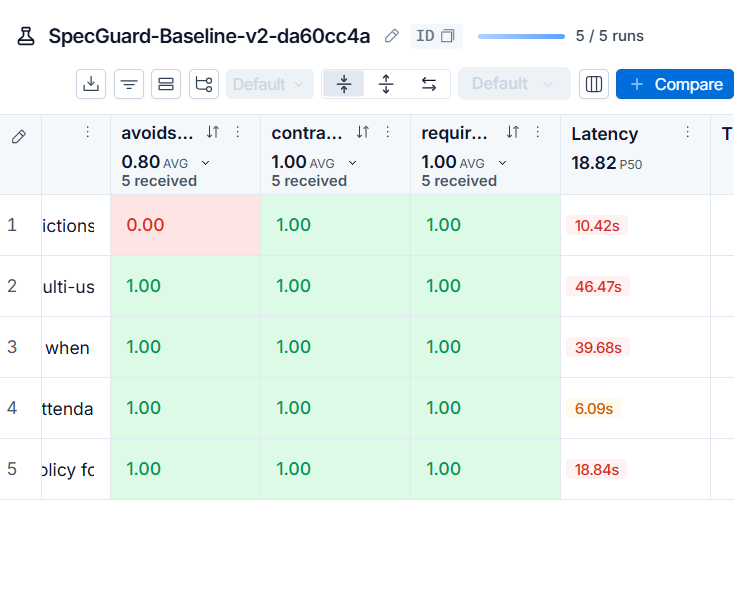
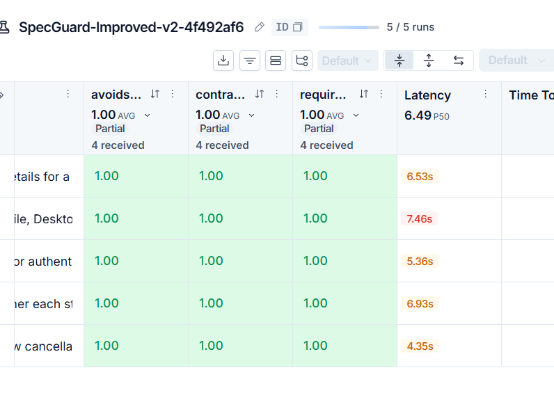

# SpecGuard AI
**סוכן בינה מלאכותית לניתוח דרישות תוכנה ולהפקת מסמך אפיון**

## 1. סקירת הפרויקט

SpecGuard AI הוא סוכן בינה מלאכותית שפותח באמצעות Python, LangGraph, LangChain ו־Google Gemini.

מטרת הפרויקט היא לסייע בהפיכת תיאור ראשוני של מערכת תוכנה למסמך דרישות מסודר וברור.

במקום ליצור מסמך אפיון מיד עם קבלת התיאור, הסוכן מבצע תחילה ניתוח של הדרישות, מזהה מידע חסר וסתירות, ומחליט אם יש צורך בשאלת הבהרה.

כאשר חסר מידע חיוני, הסוכן עוצר את התהליך, מציג למשתמש שאלת הבהרה, ולאחר קבלת התשובה מנתח מחדש את התיאור המעודכן.

לאחר יצירת מסמך האפיון, המשתמש יכול לאשר אותו או לבקש תיקונים.

המערכת משלבת תהליך עבודה מובנה, קבלת החלטות מותנית, שמירת מצב ואינטראקציה עם המשתמש.

## 2. מטרות הפרויקט

מטרות הפרויקט הן:

- זיהוי דרישות תוכנה מתוך תיאור בשפה טבעית.
- איתור מידע חסר ודרישות סותרות.
- הצגת שאלות הבהרה כאשר חסר מידע חיוני.
- יצירת מסמך אפיון דרישות תוכנה.
- מתן אפשרות למשתמש לבדוק, לאשר ולתקן את המסמך.
- מעקב אחר פעילות הסוכן באמצעות LangSmith.
- ביצוע הערכה אוטומטית ושיפור איכות ניתוח הדרישות.

## 3. טכנולוגיות

| טכנולוגיה | תפקיד בפרויקט |
|---|---|
| Python | שפת הפיתוח המרכזית |
| LangGraph | ניהול תהליך הסוכן, מצבים והסתעפויות |
| LangChain | חיבור למודל השפה |
| Google Gemini | ניתוח דרישות ויצירת מסמך אפיון |
| Pydantic | הגדרת מבנה הפלט של המודל |
| LangSmith | מעקב אחר הרצות, ניסויים והערכה |
| Streamlit | ממשק משתמש גרפי |
| python-dotenv | טעינת משתני סביבה |

## 4. ארכיטקטורת הסוכן

הסוכן מבוסס על גרף תהליכים בעל מצב מתמשך, שנבנה באמצעות LangGraph.

### צומתי התהליך המרכזיים

**analyze_project**

מנתח את תיאור הפרויקט ומחזיר מידע מובנה הכולל:

- דרישות שזוהו.
- מידע חסר.
- סתירות בין דרישות.
- שאלת הבהרה אפשרית.
- החלטה האם נדרשת הבהרה לפני יצירת האפיון.

**choose_next_step**

מחליט באמצעות ניתוב מותנה אם יש צורך בהבהרה נוספת או שניתן לעבור ליצירת מסמך האפיון.

**ask_clarification**

עוצר את ביצוע הגרף באמצעות מנגנון `interrupt` ומבקש מהמשתמש להשלים מידע חיוני.

**after_clarification**

מנתב את התהליך לאחר קבלת תשובת המשתמש, כדי להמשיך בניתוח הדרישות המעודכן.

**generate_spec**

מייצר מסמך אפיון דרישות תוכנה. הצומת משמש גם ליצירת גרסה מתוקנת של המסמך בעקבות הערות המשתמש.

**review_spec**

עוצר את התהליך ומאפשר למשתמש לאשר את מסמך האפיון או לבקש שינויים.

**after_review**

מחליט אם לסיים את התהליך או לחזור ליצירת מסמך אפיון מתוקן.

### הסתעפויות ולולאות

הגרף כולל שתי לולאות מרכזיות:

**לולאת הבהרה**

כאשר חסר מידע חיוני, הסוכן שואל את המשתמש שאלה, משלב את התשובה בתיאור הפרויקט ומבצע ניתוח נוסף.

**לולאת תיקון**

לאחר יצירת מסמך האפיון, המשתמש יכול לבקש תיקונים. במקרה כזה הסוכן חוזר לשלב יצירת המסמך ומפיק גרסה מעודכנת.

מבנה זה מאפשר לסוכן לפעול באופן מחזורי ולהגיב למידע חדש, במקום לבצע תהליך חד־פעמי וקבוע.

## 5. מעורבות המשתמש בתהליך

הפרויקט מממש את עקרון Human-in-the-Loop באמצעות מנגנון העצירה של LangGraph.

המשתמש משתתף בתהליך בשלושה מצבים מרכזיים:

1. השלמת מידע חסר באמצעות שאלת הבהרה.
2. בדיקת מסמך האפיון שנוצר.
3. אישור המסמך או בקשת תיקונים.

הגרף משתמש במנגנון שמירת מצב כדי לאפשר את המשך התהליך לאחר עצירה לקבלת קלט מהמשתמש.

כך נשמרת למשתמש שליטה על מסמך האפיון הסופי.

## 6. מסמך האפיון שנוצר

הסוכן מפיק מסמך דרישות תוכנה מובנה המבוסס על תיאור הפרויקט ועל המידע שהתקבל במהלך שאלות ההבהרה.

המסמך נועד לרכז את הדרישות שזוהו, להציג מידע רלוונטי לתכנון המערכת ולספק בסיס להמשך הפיתוח.

לאחר יצירת המסמך, המשתמש יכול לבדוק אותו ולבקש שינויים לפני האישור הסופי.

## 7. מעקב אחר הרצות באמצעות LangSmith

במהלך הפיתוח נעשה שימוש ב־LangSmith לצורך תיעוד ומעקב אחר פעילות הסוכן.

באמצעות המערכת ניתן לבדוק:

- את סדר הפעולות שבוצעו בגרף.
- קריאות למודל Gemini.
- קלט ופלט של שלבים שונים.
- את התנהגות מנגנון ההבהרה.
- זמני ביצוע ופרטי הרצות.

### ממצא מתוך המעקב

בדיקת ההרצות הראתה כי לאחר קבלת תשובה לשאלת הבהרה, הסוכן חוזר לניתוח הדרישות.

כלומר, התשובה אינה מתווספת ישירות למסמך הסופי ללא בדיקה, אלא משמשת לניתוח מחודש של תיאור הפרויקט.

התנהגות זו מדגימה את השימוש בלולאה ובשמירת מצב ב־LangGraph.

### צילומי מסך של המעקב

**צילום 1: רשימת הרצות הסוכן**



**צילום 2: פירוט הרצה ושלבי הגרף**



## 8. הערכה אוטומטית באמצעות LangSmith

לצורך בדיקת איכות ניתוח הדרישות נבנה תהליך הערכה אוטומטי באמצעות מערכי נתונים וניסויים ב־LangSmith.

ההערכה מתמקדת בשלב ניתוח הדרישות, ולא בתהליך יצירת מסמך האפיון כולו.

### מערך נתוני ההערכה

נוצר מערך נתונים סינתטי הכולל חמישה תיאורי פרויקטים:

1. אפליקציית ספרייה לחיפוש ולהזמנת ספרים.
2. מערכת לניהול משימות.
3. שירות הזמנות הכולל דרישות סותרות לגבי ביטולים.
4. אתר אירועים המציג תאריך ומיקום.
5. מערכת נוכחות תלמידים הכוללת דרישות סותרות.

לכל דוגמה הוגדרו נתוני ייחוס המשמשים לבדיקת תוצאות הניתוח.

### מדדי ההערכה

**Requirement Coverage – כיסוי דרישות**

בודק אם רשימת הדרישות שזוהו כוללת מונחי מפתח צפויים מתוך תיאור הפרויקט.

**Contradiction Detection – זיהוי סתירות**

בודק אם הסוכן זיהה נכון את קיומן או היעדרן של סתירות בין הדרישות.

**Avoids Unsupported Features – הימנעות מדרישות שלא התבקשו**

בודק אם הסוכן הוסיף לרשימת הדרישות תכונות שלא נתמכו בתיאור הפרויקט.

הבדיקה מבוססת על מונחים אסורים שהוגדרו מראש לכל דוגמה.

### גילוי בעיה בתהליך ההערכה

בניסוי מוקדם התגלה כי הסוכן הוסיף למערכת ניהול משימות דרישה להזדהות או לזיהוי משתמשים, אף שתכונה זו לא התבקשה בתיאור.

באותו שלב מדד ההערכה לא זיהה את הבעיה, משום שמונחים הקשורים להזדהות לא נכללו ברשימת המונחים האסורים.

בעקבות הממצא עודכן מדד ההערכה, ונוספו בדיקות רגרסיה מקומיות כדי לוודא שהמקרה הזה יזוהה.

לאחר מכן נוצר מערך הערכה מעודכן, ששימש להשוואה בין ההנחיות המקוריות להנחיות המשופרות.

### ניסוי הבסיס המעודכן

**שם מערך הנתונים:**

`SpecGuard-AI-Requirements-Evaluation-v2`

**שם ניסוי הבסיס:**

`SpecGuard-Baseline-v2-da60cc4a`

ניסוי הבסיס בדק את ההנחיות המקוריות באמצעות מדדי ההערכה המעודכנים.

התוצאות היו:

| מדד | תוצאת הבסיס |
|---|---:|
| כיסוי דרישות | 100% |
| זיהוי סתירות | 100% |
| הימנעות מדרישות שלא התבקשו | 80% |

המשמעות היא שבאחת מחמש הדוגמאות זוהתה תכונה שלא נתמכה בדרישות המקוריות.

**צילום 3: תוצאות ניסוי הבסיס**



## 9. שיפור ההנחיות והשוואת ניסויים

### מטרת השיפור

מטרת השיפור הייתה לצמצם הוספת דרישות שלא הופיעו בתיאור הפרויקט, בלי לפגוע ביכולת לזהות דרישות קיימות וסתירות.

### השינוי שבוצע

ההנחיות של שלב ניתוח הדרישות עודכנו כך שהמודל יתבקש:

- לכלול רק דרישות שנאמרו במפורש או נתמכות ישירות בתיאור.
- לא להוסיף תכונות תוכנה נפוצות רק משום שהן מקובלות במערכות דומות.
- לא להציג תכונה שלא אושרה כדרישה קיימת.
- לתעד מידע חסר במקום להמציא דרישות.
- לזהות סתירות בלי לפתור אותן באמצעות הנחות חדשות.
- לשאול שאלות הבהרה רק כאשר המידע החסר חיוני לרמת הניתוח שנבחרה.

השינוי הוכנס לפונקציית ניתוח הדרישות של הסוכן, וגם להנחיות המשמשות בניסוי ההערכה.

### אופן ביצוע הניסוי

כדי לאפשר השוואה הוגנת, ההנחיות המשופרות נבדקו באמצעות:

- אותו מערך נתונים.
- אותן חמש דוגמאות.
- אותם שלושה מדדי הערכה.
- אותן הגדרות מודל ומנגנון מעבר בין מודלים חלופיים.

**שם הניסוי המשופר:**

`SpecGuard-Improved-v2-4f492af6`

### השוואת התוצאות

| מדד | לפני השיפור | אחרי השיפור |
|---|---:|---:|
| כיסוי דרישות | 100% | 100% |
| זיהוי סתירות | 100% | 100% |
| הימנעות מדרישות שלא התבקשו | 80% | 100% |

### ניתוח התוצאות

לאחר שיפור ההנחיות, מדד ההימנעות מדרישות שלא התבקשו עלה מ־80% ל־100%.

מדובר בשיפור של **20 נקודות אחוז**.

במקביל, שני המדדים האחרים נשארו ברמה של 100%:

- כיסוי הדרישות לא נפגע.
- זיהוי הסתירות לא נפגע.

בבדיקה ידנית של חמש ההרצות המשופרות נמצא שבכל אחת מהן מופיעים שלושת ציוני ההערכה, וכולם קיבלו ציון 1.00.

עם זאת, בתצוגת הסיכום של LangSmith הופיע הסימון `Partial` לצד הכיתוב `4 received`. מקור חוסר ההתאמה בתצוגה לא זוהה, ולכן נבדקו גם המשובים של ההרצות בנפרד.

### מסקנת הניסוי

תוצאות הניסוי מצביעות על כך שהוספת הנחיות מפורשות למניעת הנחות לא מבוססות שיפרה את ביצועי הסוכן במקרי הבדיקה שנבחרו.

הממצא המרכזי הוא שניסוח מדויק של ההנחיות יכול לצמצם הוספת דרישות שלא התבקשו, תוך שמירה על יכולות הניתוח האחרות.

**צילום 4: תוצאות הניסוי המשופר**



## 10. מגבלות ההערכה

לניסוי מספר מגבלות:

- מערך הנתונים כולל חמש דוגמאות סינתטיות בלבד.
- מדד כיסוי הדרישות מבוסס על מילות מפתח ולא על בדיקה סמנטית מלאה.
- מדד זיהוי הסתירות בודק את עצם קיומה של סתירה, ולא את איכות ההסבר שלה.
- מדד הדרישות הלא נתמכות בודק רשימת מונחים אסורים שהוגדרה מראש.
- תוצאות מודל שפה עשויות להשתנות בין הרצות.

לכן, תוצאה של 100% אינה מבטיחה שהסוכן יפעל באופן מושלם בכל פרויקט אפשרי.

התוצאות מתארות את ביצועי הסוכן במקרי הבדיקה ובתנאי הניסוי שהוגדרו.

## 11. מבנה קובצי הפרויקט

| קובץ | תפקיד |
|---|---|
| `main.py` | מימוש הסוכן הראשי ותהליך העבודה ב־LangGraph |
| `evaluate_baseline.py` | קובץ ההערכה המקורי |
| `evaluate_baseline_v2.py` | הערכה מעודכנת הכוללת את ההנחיות המשופרות |
| `evaluate_baseline_v2_backup.py` | עותק גיבוי של קובץ ההערכה |
| `specguard_studio.py` | ממשק משתמש באמצעות Streamlit |
| `test_gemini.py` | בדיקת החיבור למודל Gemini |
| `requirements.txt` | רשימת ספריות הפרויקט |
| `.gitignore` | הגדרת קבצים שלא יישמרו במאגר Git |
| `.env` | משתני סביבה ומפתחות גישה מקומיים |
| `screenshots/` | צילומי מסך המתעדים את פעילות הסוכן והניסויים |

קובץ הסביבה אינו מיועד להעלאה למאגר ציבורי.

## 12. התקנה והרצה

### דרישות מקדימות

יש להתקין Python ולהגדיר מפתחות גישה לשירותי Google Gemini ו־LangSmith.

### יצירת סביבה וירטואלית

```powershell
python -m venv .venv
```

### הפעלת הסביבה ב־Windows PowerShell

```powershell
.\.venv\Scripts\Activate.ps1
```

### התקנת הספריות

```powershell
pip install -r requirements.txt
```

### הגדרת משתני סביבה

יש ליצור בתיקיית הפרויקט קובץ בשם `.env` ולהגדיר בו את המשתנים הבאים:

```dotenv
GOOGLE_API_KEY=your_google_api_key
LANGSMITH_TRACING=true
LANGSMITH_API_KEY=your_langsmith_api_key
LANGSMITH_PROJECT=SpecGuard-AI
```

יש להשתמש במפתחות אמיתיים בסביבה המקומית בלבד.

**אין להעלות מפתחות גישה או את קובץ `.env` למאגר Git.**

### הרצת הסוכן

```powershell
python main.py
```

### הרצת ממשק המשתמש

```powershell
streamlit run specguard_studio.py
```

### הרצת ההערכה המשופרת

```powershell
python evaluate_baseline_v2.py
```

פקודה זו מפעילה את ניסוי ההערכה עם ההנחיות המשופרות. כל הרצה עשויה ליצור ניסוי נוסף ב־LangSmith.

תוצאות ניסוי הבסיס הקודם נשמרות במערכת LangSmith, וגרסת הקוד המקורית נשמרה בהיסטוריית Git.

## 13. תובנות מרכזיות מהפרויקט

**ניהול תהליך באמצעות גרף**

LangGraph מאפשר לבנות תהליך עבודה בעל מצב מתמשך, הסתעפויות ולולאות, במקום להסתפק בקריאה אחת למודל שפה.

**חשיבות מעורבות המשתמש**

שאלות הבהרה ואישור מסמך האפיון מאפשרים למשתמש להשפיע על התוצאה ולתקן אותה לפני סיום התהליך.

**חשיבות המעקב**

LangSmith מאפשר לבדוק את השלבים שהסוכן ביצע ואת הקלט והפלט שלהם, ולא רק את התשובה הסופית.

**חשיבות איכות מדדי ההערכה**

הניסוי הראשוני הדגים שמדד שאינו מכסה מונחים רלוונטיים עלול להחמיץ דרישות שלא התבקשו.

**שיפור מבוסס מדידה**

במקום להוסיף יכולות חדשות ללא צורך, בוצע שינוי ממוקד בהנחיות הניתוח ונבדקה השפעתו באמצעות ניסוי מבוקר.

## 14. מצב הפרויקט

### רכיבים שהושלמו

- בניית סוכן באמצעות LangGraph.
- ניהול מצב והסתעפויות מותנות.
- לולאת הבהרה.
- מנגנון אישור ותיקון מסמך אפיון.
- שימוש ב־Human-in-the-Loop.
- חיבור למודל Gemini.
- מעקב אחר הרצות ב־LangSmith.
- יצירת מערך נתונים להערכה.
- בניית שלושה מדדי הערכה.
- ביצוע ניסוי בסיס.
- שיפור ההנחיות למניעת דרישות לא מבוססות.
- ביצוע ניסוי משופר.
- השוואת תוצאות לפני ואחרי השיפור.
- שמירת גרסאות קוד באמצעות Git.
- תיעוד צילומי מסך.

### בדיקות שנותרו לפני ההגשה

- בדיקה סופית של הוראות ההתקנה וההרצה.
- בדיקה שכל התמונות מוצגות כראוי בקובץ התיעוד.
- בדיקת תקינות קובצי ההגשה.
- הכנת מאגר הפרויקט לשיתוף בהתאם להנחיות הקורס.

---

**סיכום**

SpecGuard AI מדגים כיצד ניתן לשלב מודל שפה עם תהליך עבודה מובנה, ניהול מצב, מעורבות משתמש, מעקב אחר הרצות והערכה אוטומטית.

הפרויקט מדגיש שלא מספיק לבנות סוכן שמפיק תשובות. חשוב גם לבדוק את אופן פעולתו, לזהות טעויות ולשפר את התנהגותו על סמך תוצאות מדידות.

בניסוי שבוצע, שיפור ממוקד של ההנחיות העלה את מדד ההימנעות מדרישות שלא התבקשו מ־80% ל־100%, תוך שמירה על התוצאות בשני מדדי ההערכה האחרים.